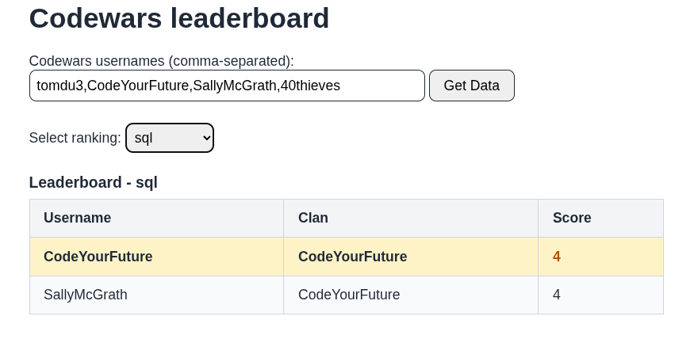
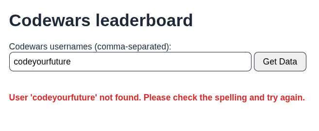
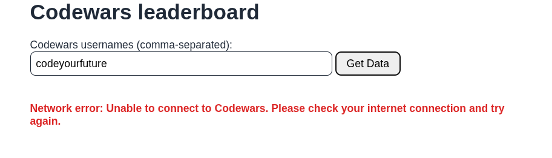
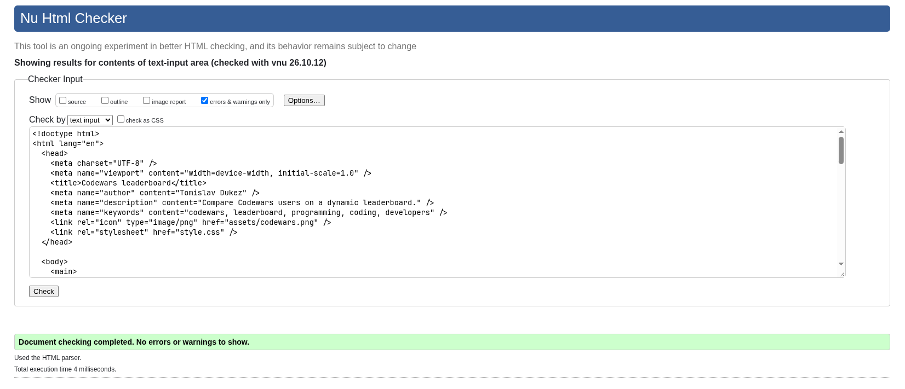

# Testing Documentation

This document outlines the testing strategy and verifies that each requirement from the project rubric has been tested and verified.

## Rubric Requirements Testing

- [x] 1. The website must contain an input to accept a comma-separated list of users
  - The website contains an `<input>` element with `id="usernames-input"` and an explicitly associated `<label for="usernames-input">`.
  - It accepts multiple Codewars usernames separated by commas (e.g., `CodeYourFuture, 40thieves, SallyMcGrath`).
  - Native HTML validation attributes `required` and `minlength="3"` ensure that empty submissions and submissions under 3 characters are prevented.

    

- [x] 2. Submitting the list of users fetches data from the Codewars API about each of the users
  - When the user submits the form via the "Get Data" button or pressing Enter, the `submit` event triggers `fetchMultipleUsers()`.
  - The function splits and trims usernames, removes duplicates, and fetches user profiles concurrently from `https://www.codewars.com/api/v1/users/{username}` using `Promise.all`.
  - A loading indicator (`<p>Loading...</p>`) is shown while requests are in flight.
    

- [x] 3. Based on the leaderboard data, a drop-down is shown, allowing the user to pick from all of the possible language rankings plus the overall ranking
  - Once user data is fetched, `getAvailableLanguages()` extracts all unique languages from the `ranks.languages` property of all valid users.
  - The `#language-select-container` is displayed (unhidden), containing a `<select id="language-select">` with options for "Overall" and each unique language found across all users sorted alphabetically.

    


- [x] 4. The default ranking selected is the overall ranking
  - The dropdown defaults to `<option value="overall" selected>Overall</option>`.
  - Upon fetching, the table immediately renders the "Overall" ranking data by default.

- [x] 5. A table is shown for the current ranking, with columns for each user's username, clan and score
  - The leaderboard table is instantiated using an HTML `<template>` element with `<th>` column headers for `Username`, `Clan`, and `Score`.
  - Each ranked user has a corresponding row in `<tbody>` displaying their username, clan (or empty if none), and score.

- [x] 6. Changing the selected ranking will update the table to reflect the newly selected ranking
  - A `change` event listener on `#language-select` triggers `renderTable(languageSelect.value)`.
  - When a language is selected (e.g., JavaScript or SQL), the table updates in real time to show rankings and scores specific to that language.

    

- [x] 7. The table is sorted from the highest to lowest score, top to bottom
  - The `getLeaderboard()` helper function sorts users descending by score: `(a, b) => b.score - a.score`.
  - The user with the highest score is positioned at the top, and subsequent users follow in decreasing order.

    

- [x] 8. Users without a ranking in a chosen language are not shown in that table
  - `getLeaderboard()` checks whether `user.ranks.languages[ranking]?.score` exists and is a valid number.
  - If a user has not completed katas in the selected language, they are omitted from the table.
  - If no users have a ranking in the chosen language, a message is shown indicating no users were found for that language.

    

- [x] 9. The top user's score is visually highlighted
  - The first row in the sorted table receives the `.top-user` class (golden-tinted background), and the score cell receives `.top-score` (bold with amber color) to visually highlight the top achiever.

- [x] 10. The website must score 100% for accessibility in Lighthouse in the Desktop device mode, for all views in the website
  - The website was tested using Google Lighthouse in Desktop mode and scored 100% for accessibility across all views.

- [x] 11. Unit tests must be written for at least one non-trivial function
  - Comprehensive unit tests are implemented in [`utils.test.mjs`](./utils.test.mjs) testing four key utility functions:
    - `makeFetchRequest()`: verifies API data fetching, 404 error throwing, and network error handling.
    - `fetchMultipleUsers()`: verifies concurrent fetching, handling missing users, deduplication, empty inputs, network errors, server 500 errors, and rate limits.
    - `getAvailableLanguages()`: verifies language extraction, deduplication, sorting, and edge cases.
    - `getLeaderboard()`: verifies filtering, sorting descending by score, language-specific filtering, and handling missing clans.
  - Running `npm test` passes all 18 unit tests:

  ```
  ✔ makeFetchRequest() fetches user data from codewars API (12.430291ms)
  ✔ makeFetchRequest() throws an error for invalid username (2.499388ms)
  ✔ fetchMultipleUsers() fetches multiple user data from codewars API (3.990349ms)
  ✔ fetchMultipleUsers() returns array conaining error objects for the users that are not found (4.027639ms)
  ✔ fetchMultipleUsers() returns array with one error object when only one user is not found (1.961965ms)
  ✔ fetchMultipleUsers() removes duplicate usernames (3.060141ms)
  ✔ fetchMultipleUsers() returns empty array when no usernames are provided (0.147898ms)
  ✔ fetchMultipleUsers() returns array of error objects when all users are not found (2.529548ms)
  ✔ fetchMultipleUsers() throws actionable network error when network fails (2.108193ms)
  ✔ fetchMultipleUsers() throws server error when Codewars returns 500 (1.790647ms)
  ✔ fetchMultipleUsers() throws rate limit error when Codewars returns 429 (1.846426ms)
  ✔ getAvailableLanguages() returns ['overall'] for empty input or non-array (0.204787ms)
  ✔ getAvailableLanguages() extracts and sorts unique languages from users plus 'overall' (0.118828ms)
  ✔ getAvailableLanguages() ignores error objects and users without language rankings (0.104308ms)
  ✔ getLeaderboard() returns empty array for invalid inputs (0.137858ms)
  ✔ getLeaderboard() sorts users by overall score descending (0.137258ms)
  ✔ getLeaderboard() filters and sorts by specific language, omitting users without that language (0.128878ms)
  ✔ getLeaderboard() handles missing clan and ignores error objects (0.086598ms)
  ℹ tests 18
  ℹ suites 0
  ℹ pass 18
  ℹ fail 0
  ℹ cancelled 0
  ℹ skipped 0
  ℹ todo 0
  ℹ duration_ms 115.112053
  ```

- [x] 12. The project must not contain any dead code. All written JavaScript and CSS must be used.
  - There is no unused or dead code.

- [x] 13. Searching for a user which doesn't exist should show a message to the user explaining this
  - If a user does not exist (404 from Codewars), a message is displayed: `User '<username>' not found. Please check the spelling and try again.`
  - If multiple users are entered where some exist and some do not, the valid users are rendered in the leaderboard table while each invalid user is clearly reported in the error section.

    

- [x] 14. If fetching from the Codewars API errors (e.g. because you're offline, or made a bad request), the user must be shown a useful error message in the UI
  - If the browser is offline (`!navigator.onLine`) or `fetch` fails due to network loss, the UI displays: `"You appear to be offline. Please check your internet connection and try again."` or `"Network error: Unable to connect to Codewars. Please check your internet connection and try again."`.
  - If the server returns a 500 error, the UI displays: `"Codewars server error (500). Please try again later."`.
  - If rate limited (429), the UI displays: `"Rate limit exceeded while connecting to Codewars. Please wait a moment and try again."`.

    

- [x] 15. Error messages should not make misleading claims about what went wrong, and it should be clear what the user should do about it to rectify the situation
  - Error handling explicitly differentiates network errors, 5xx server issues, 429 rate limits, and 404 not found errors.
  - Network and server failures are never misreported as "User not found".
  - Every error message includes an actionable remedy: verifying username spelling, checking network connection, or waiting before retrying.

## Additional Validation

### HTML Validation

The HTML markup was validated using the W3C Nu HTML Checker:
- Verified valid HTML5 semantic structure: `<main>`, `<form>`, `<label>`, `<input>`, `<button>`, `<select>`, `<template>`, and `<table id="leaderboard-table">`.
- Ensured form control labels match their respective input IDs (`for="usernames-input"`, `for="language-select"`).
- Ensured table accessibility with `<caption>` and `<th scope="col">`.
- Ensured ARIA live regions (`aria-live="polite"`, `role="alert"`) are correctly used without invalid ARIA references.


