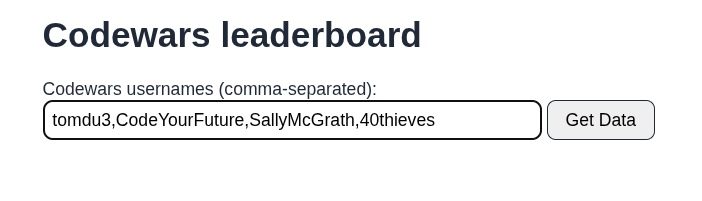
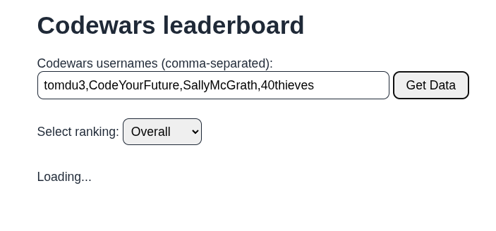
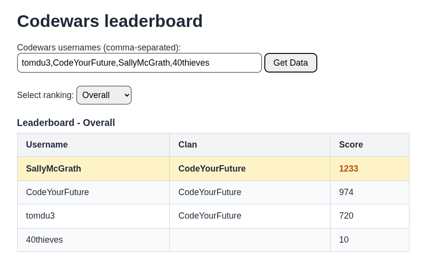

# Testing Documentation

This document outlines the testing strategy and verifies that each requirement from the project rubric has been tested and verified.

## Rubric Requirements Testing

- [x] 1. The website must contain an input to accept a comma-separated list of users
  - The website contains an `<input>` element with `id="usernames-input"` and an explicitly associated `<label for="usernames-input">`.
  - It accepts multiple Codewars usernames separated by commas (e.g., `CodeYourFuture, 40thieves, SallyMcGrath`).
  - Native HTML validation attributes `required` and `minlength="3"` ensure that empty submissions and submissions under 3 characters are prevented.

    

- [x] 2. Submitting the list of users fetches data from the Codewars API about each of the users
  - When the user submits the form via the "Get Data" button or pressing Enter, the `submit` event triggers `fetchMultipleUsers()`.
  - The function splits and trims usernames, removes duplicates, and fetches user profiles concurrently from `https://www.codewars.com/api/v1/users/{username}` using `Promise.all`.
  - A loading indicator (`
Loading...
`) is shown while requests are in flight.
    

- [x] 3. Based on the leaderboard data, a drop-down is shown, allowing the user to pick from all of the possible language rankings plus the overall ranking
  - Once user data is fetched, `getAvailableLanguages()` extracts all unique languages from the `ranks.languages` property of all valid users.
  - The `#language-select-container` is displayed (unhidden), containing a `<select id="language-select">` with options for "Overall" and each unique language found across all users sorted alphabetically.

    

- [x] 4. The default ranking selected is the overall ranking
  - The dropdown defaults to `<option value="overall" selected>Overall</option>`.
  - Upon fetching, the table immediately renders the "Overall" ranking data by default.

- [x] 5. A table is shown for the current ranking, with columns for each user's username, clan and score
  - The leaderboard table is instantiated using an HTML `<template>` element with `<th>` column headers for `Username`, `Clan`, and `Score`.
  - Each ranked user has a corresponding row in `<tbody>` displaying their username, clan (or empty if none), and score.

- [x] 6. Changing the selected ranking will update the table to reflect the newly selected ranking
  - A `change` event listener on `#language-select` triggers `renderTable(languageSelect.value)`.
  - When a language is selected (e.g., JavaScript or SQL), the table updates in real time to show rankings and scores specific to that language.

    

- [x] 7. The table is sorted from the highest to lowest score, top to bottom
  - The `getLeaderboard()` helper function sorts users descending by score: `(a, b) => b.score - a.score`.
  - The user with the highest score is positioned at the top, and subsequent users follow in decreasing order.

    